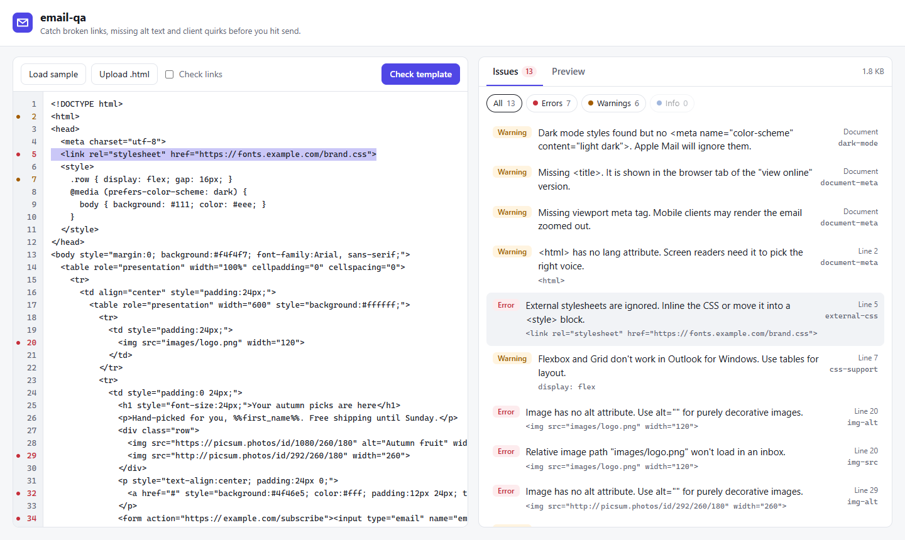

# email-qa

Static checks for HTML email templates. Paste or upload a template, get a list of problems with line numbers before it goes out to a real inbox.

Most email bugs that reach production are not rendering puzzles. They are small things that slip through: a `href="#"` left over from the design handoff, an image without `alt`, a relative image path, a template that grew past Gmail's clipping limit. This tool catches those.



## What it checks

| Rule | Severity | What it catches |
| --- | --- | --- |
| `link-href` | error / warning | empty, `#`, `javascript:` or relative links; `http://` links |
| `img-alt` | error | images without an `alt` attribute |
| `img-src` | error / warning | relative paths, base64 images, `http://` images |
| `img-width` | warning | images without a `width` attribute (Outlook) |
| `unsupported-elements` | error / warning | `script`, `iframe`, `form`, `video`, inline `svg`, ... |
| `external-css` | error / warning | `<link rel="stylesheet">` and `@import` |
| `css-support` | warning | flexbox, grid and `position` in inline styles or `<style>` |
| `gmail-clipping` | error / warning | HTML over (or close to) Gmail's ~102 KB limit |
| `dark-mode` | warning / info | dark mode styles without the `color-scheme` meta tag |
| `document-meta` | warning | missing `lang`, `<title>` or viewport meta |
| `link-status` | error / warning | links that answer 4xx/5xx or don't answer at all (opt-in) |

ESP merge tags such as `%%field%%`, `{{ var }}`, `*|UNSUB|*` and `#SPCUNSUBSCRIBE#` are treated as valid link targets.

## Project structure

```
packages/
  core/   the checker: TypeScript, no DOM needed, runs in Node or the browser
  api/    NestJS REST API; also serves the built UI in production
  web/    React + Vite UI: editor, issue list, sandboxed preview
```

The rules live in `core` and have no idea there is a server. The API adds the parts that need one: file uploads, size limits, and the link check.

## Running it

Requires Node 20+.

```bash
npm install
npm run dev      # API on :3000, UI on :5173 with hot reload
npm test         # core, API and UI tests
npm run build && npm start   # production build, UI + API on :3000
```

Or with Docker:

```bash
docker build -t email-qa .
docker run -p 3000:3000 email-qa
```

## API

| Method | Path | Body | Returns |
| --- | --- | --- | --- |
| `POST` | `/api/analyze` | `{ "html": "...", "checkLinks": false }` | report |
| `POST` | `/api/analyze/upload?checkLinks=false` | multipart, `.html` file in `file` | report |
| `GET` | `/api/rules` | | rule ids and descriptions |
| `GET` | `/api/health` | | `{ "status": "ok" }` |

```bash
curl -s localhost:3000/api/analyze \
  -H 'content-type: application/json' \
  -d '{"html":"<a href=\"#\">Shop now</a>"}'
```

```json
{
  "sizeBytes": 24,
  "counts": { "error": 1, "warning": 2, "info": 1 },
  "issues": [
    { "rule": "link-href", "severity": "error", "line": 1,
      "message": "Placeholder link \"#\". Replace it with the real URL.",
      "snippet": "<a href=\"#\">" }
  ]
}
```

(The response is trimmed; the full one also lists the document-level warnings.) Templates are limited to 1 MB.

### The link check and SSRF

`checkLinks: true` makes the server request every link in the template. A server that fetches URLs chosen by its users can be pointed at things only it can reach: `localhost`, the private network, or the cloud metadata endpoint at `169.254.169.254`. So the API resolves each host first and refuses loopback, private, link-local and reserved addresses. It follows redirects itself so every hop gets the same check, not just the first URL.

One gap is left on purpose and documented in `safe-fetch.ts`: the host is resolved once for the check and again by `fetch`, so a DNS server that changes its answer in between (DNS rebinding) could get through. Closing it needs a connect-time check in a custom HTTP dispatcher.

## Using the checker as a library

```ts
import { analyze, checkLinks } from "@email-qa/core";

const report = analyze(html);
report.counts; // { error: 2, warning: 1, info: 0 }
report.issues; // [{ rule, severity, message, line, snippet }, ...]

const linkIssues = await checkLinks(html, { timeoutMs: 5000 });
```

`analyze` takes an optional second argument with your own list of rules.

## Roadmap

- [x] Core rules with line numbers and snippets
- [x] REST API (upload a file or post HTML, get the report as JSON)
- [x] Web UI with the template preview and issues side by side
- [x] Optional link check with SSRF protection
- [x] Docker image and CI
- [ ] Auto-fix suggestions for the simple cases (missing `alt=""`, `http://` to `https://`)
- [ ] Check the plain-text part of a multipart email
